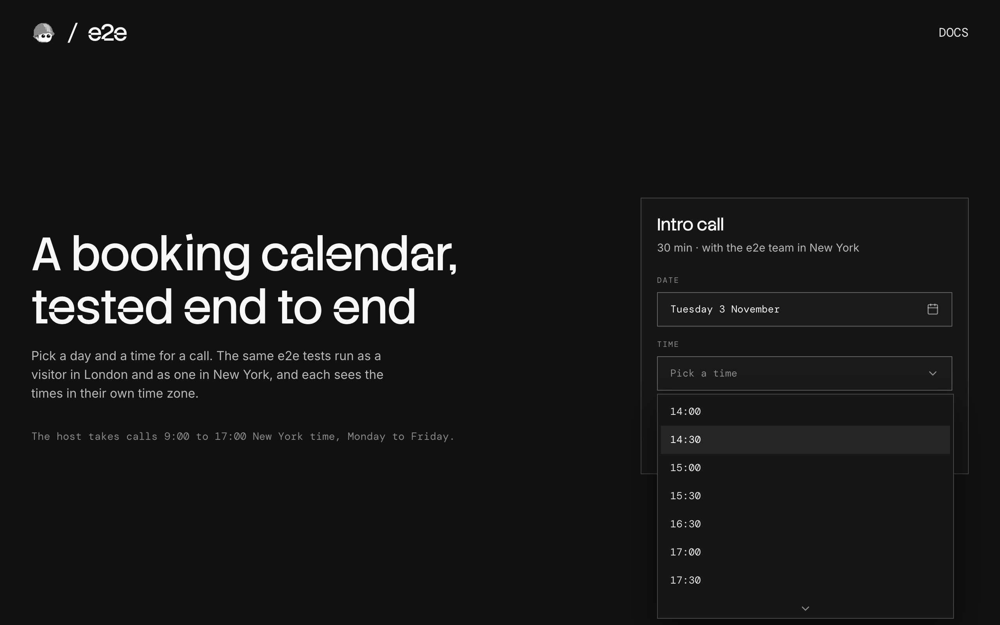

# e2e-calendar

A booking calendar for a 30-minute call, used as an example of end-to-end testing a date picker, a dropdown, and time zones with [e2e](https://www.npmjs.com/package/e2e). The same tests run as a visitor in London and as one in New York.



## How it works

- **Booking card** (`components/booking-card.tsx`) has shadcn/ui's Calendar in a popover and its Select. Picking a day asks for that day's free times in the browser's time zone, and the list shows them on the visitor's own clock.
- **`GET /api/slots`** (`app/api/slots/route.ts`, `lib/schedule.ts`) returns the host's free 30-minute slots for that day as UTC times.
- **Confirmation** (`app/booked/page.tsx`) checks the slot on the server and shows it in your time zone, next to the host's time.

The host takes calls 9:00 to 17:00 New York time, Monday to Friday. There is no database, so nothing is stored when you book, and the one taken slot (Tuesdays at 11:00 New York time) is fixed in code. The server never formats a time for the visitor: only UTC times cross the network, and the browser formats them.

### One Tuesday

| New York (host) | London |                |
| --------------- | ------ | -------------- |
| 9:00 AM         | 14:00  | The first slot |
| 9:30 AM         | 14:30  |                |
| 10:00 AM        | 15:00  |                |
| 11:00 AM        | 16:00  | Taken          |
| 2:30 PM         | 19:30  |                |
| 4:30 PM         | 21:30  | The last slot  |

London is 5 hours ahead of New York, except for a few weeks a year when only one of them has changed its clocks.

## Getting started

```bash
npm install
npm run dev
```

Open [http://localhost:3000](http://localhost:3000). The app needs no keys.

## End-to-end tests

`e2e.config.ts` declares two targets with their own `timezoneId` and `locale`, London (`en-GB`) and New York (`en-US`), so every test runs once as each visitor. The tests read the browser's time zone and locale and compute what to expect from them, never from a fixed offset.

In `tests/booking.e2e.ts` the agent drives the date picker and the time list with one goal per test: "book next Tuesday at 14:30" (14:30 in London, 2:30 PM in New York), "book next Tuesday at 10:00 New York time" (the London agent has to find 15:00), a booking with the mouse switched off, and picking a day. Exact checks then pin each outcome: the confirmation carries the booked time in `<time datetime>`, and the Time list must match the `/api/slots` answer the page received. `agent.assert` with a screenshot and `agent.extract` check that past days and weekends can't be picked. `tests/home.e2e.ts` uses locators only and needs no key.

e2e's agent doesn't see focus move, so the mouse-off test presses Enter on named controls rather than walking the calendar with the arrow keys.

The agent's model goes through the Vercel AI Gateway, so set `AI_GATEWAY_API_KEY` (or link a Vercel project). Then, with the dev server running:

```bash
npm run test:e2e
```

To run as one visitor, add `--target london` or `--target new-york`. To test a different URL, set `APP_URL`.

## Scripts

| Command            | Description          |
| ------------------ | -------------------- |
| `npm run dev`      | Start the dev server |
| `npm run build`    | Build for production |
| `npm run lint`     | Run ESLint           |
| `npm run format`   | Format with Prettier |
| `npm run test:e2e` | Run the e2e tests    |
